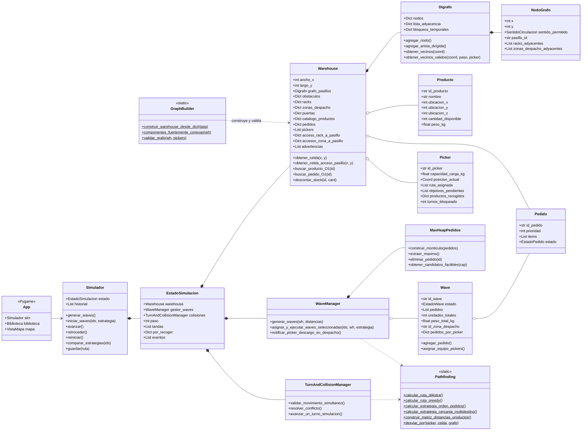
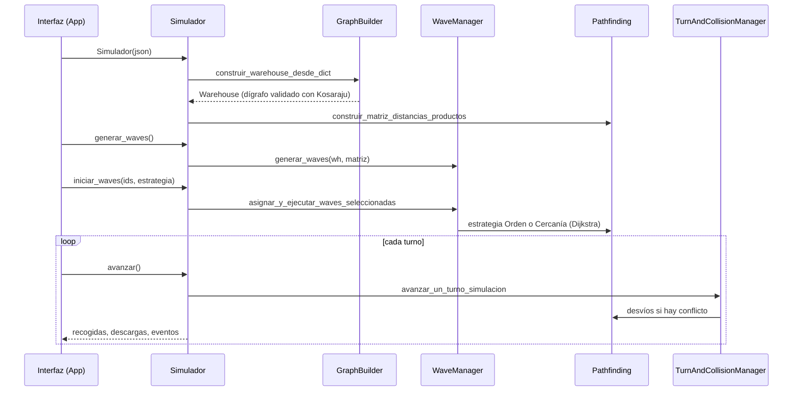

# Arquitectura

## Capas

El enunciado pide separar como mínimo
**Warehouse → Products/Orders → Wave Manager → Pathfinding → Simulation → Visualization**.
Cada capa está en un módulo propio, y una capa solo usa las que están arriba
de ella en la lista:

| Capa | Módulo | Responsabilidad |
|---|---|---|
| Warehouse | `BackEnd/models/warehouse.py`, `BackEnd/utils/graph_builder.py` | Dígrafo de pasillos, obstáculos, accesos a racks y zonas, validación con Kosaraju. |
| Products / Orders | `BackEnd/models/entities.py` | `Producto`, `Pedido`, `DetallePedido`, `Picker`, `Wave`, `ZonaDespacho`, `Puerta`. El `Warehouse` los indexa en diccionarios (O(1)). |
| Wave Manager | `BackEnd/controllers/wave_manager.py`, `BackEnd/data_structures/max_heap_pedidos.py` | Arma las waves (Max-Heap por prioridad + costo marginal en el dígrafo) y las asigna a los pickers más cercanos. |
| Pathfinding | `BackEnd/controllers/path_finding.py` | Dijkstra punto a punto y multidestino, y las estrategias *Orden de pedidos* y *Cercanía*. |
| Simulation | `BackEnd/controllers/turn_collision_manager.py`, `BackEnd/controllers/simulador.py` | Mueve a todos los pickers un paso por turno evitando choques. El `Simulador` orquesta todo y agrega historial, comparación y sesiones. |
| Visualization | `FrontEnd/` | Pygame. Solo llama al `Simulador` (a través de `FrontEnd/services/biblioteca.py`). |

Entrada y salida:

- `BackEnd/utils/file_parser.py` lee y escribe los JSON.
- `BackEnd/utils/validador_escenario.py` valida un JSON antes de construirlo.
- `BackEnd/utils/scenario_generator.py` genera escenarios de forma determinista.

## Diagrama de clases

## Flujo de una simulación

## Decisiones de la capa de simulación

- **Historial para retroceder.** Cada 10 turnos se guarda una copia completa
  del estado. El grafo, los obstáculos y la matriz de distancias no se
  copian, porque no cambian. Para volver a un turno intermedio se parte de la
  copia anterior y se re-simula; la simulación es determinista, así que se
  llega exactamente al mismo estado. El historial ocupa unas 10 veces menos
  memoria y retroceder un paso cuesta a lo sumo 9 turnos de simulación.
- **Sesiones.** Al guardar se escribe el escenario inicial más la lista de
  acciones (generar waves, iniciar, avanzar *n*, retroceder…). Al cargar, las
  acciones se repiten y se llega al mismo turno, con el historial completo.
- **Comparación.** `comparar_estrategias` copia el estado, corre las mismas
  waves con cada estrategia hasta el final y devuelve las métricas. La
  simulación real no se modifica.
- **Cola de espera.** Si se eligen más waves que pickers libres, las que
  sobran quedan en espera. Se asignan solas cuando un picker descarga.
