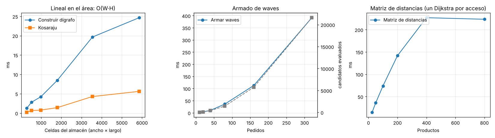
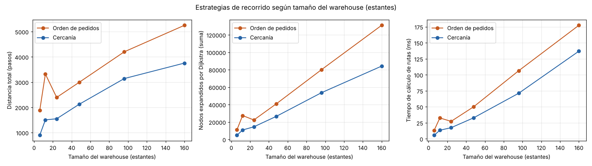
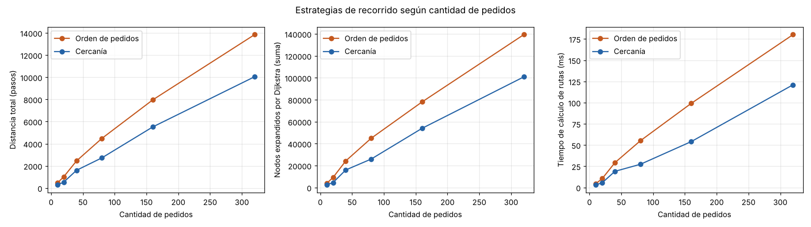

# Informe de análisis algorítmico

**Sistema de Wave Picking · Algoritmos II**

Este informe explica cómo se modeló el almacén, qué algoritmos se usan en cada
etapa y por qué, cuánto cuestan y qué muestran los experimentos. Al final
están las respuestas a las preguntas del enunciado (sección 22).

Documentos relacionados:

- `docs/EXPLICACION_GRAFO.md`: detalle del modelo del almacén.
- `docs/ARQUITECTURA.md`: módulos y diagramas.
- `docs/experimentos/resultados.md`: tablas completas de los experimentos.

---

## 1. Resumen del sistema

1. Se lee un escenario en JSON y se construye el **Warehouse**. El modelo es
   un **dígrafo** cuyos nodos son las celdas de pasillo y cuyas aristas son
   los pasos permitidos según el sentido de circulación. Se valida con
   **Kosaraju**.
2. Se calcula una **matriz de distancias** entre las ubicaciones de los
   productos, con un Dijkstra desde cada celda de acceso.
3. El **WaveManager** arma las waves. Toma con un **Max-Heap** el pedido
   pendiente de mayor prioridad y le suma los pedidos más cercanos en el
   dígrafo, respetando la capacidad de la wave, el stock, la capacidad de las
   zonas de despacho y la de los pickers.
4. Cada wave elegida se asigna a los pickers libres más cercanos. La ruta se
   calcula con una de las dos estrategias: **Orden de pedidos** o
   **Cercanía**. Las dos usan Dijkstra sobre el dígrafo.
5. El **gestor de turnos y colisiones** mueve a todos los pickers un paso por
   turno. Evita que dos pickers ocupen la misma celda, que se crucen de frente
   o que queden trabados.
6. El **Simulador** registra qué recoge cada picker y cuándo lo entrega.
   Permite avanzar, retroceder y reiniciar, compara las estrategias y guarda
   la sesión.
7. La **interfaz Pygame** muestra todo y deja interactuar.

---

## 2. Modelado del Warehouse (preguntas 1 y 2)

**Dígrafo de pasillos con lista de adyacencia indexada por coordenada.**

| Elemento | Representación | Motivo |
|---|---|---|
| Celda de pasillo | Nodo `(x, y)` en `Digrafo.nodos` (dict) | La posición es la identidad natural: se llega al nodo en O(1) desde el JSON. |
| Paso permitido | Arista dirigida de costo 1 en `lista_adyacencia` | Los pasillos tienen sentido: un grafo no dirigido no puede representarlo. |
| Rack, zona, puerta | Obstáculo en `Warehouse.obstaculos` (dict) | El picker no los atraviesa; se recogen desde el pasillo de al lado. |
| Producto en altura | `CeldaRack.productos_en_z` (dict por nivel z) | Cada posición `<x,y,z>` guarda un solo producto. |
| Dónde frenar por un producto | `acceso_rack_a_pasillo[(x,y)]` | Se calcula una vez al construir; consultarlo es O(1). |
| Productos y pedidos | `catalogo_productos`, `pedidos` (dict por id) | Búsqueda y actualización de estado y stock en O(1). |

La lista de adyacencia es mejor que una matriz porque el grafo es **ralo**:
cada celda tiene a lo sumo 4 vecinos, así que E ≤ 4N. Ocupa O(N + E) en vez de
O(N²), y obtener los vecinos de un nodo, que es la operación central de
Dijkstra, cuesta O(1). En el escenario grande hay N = 1898 nodos y E = 6048
aristas. Una matriz tendría 3,6 millones de celdas.

---

## 3. Algoritmos utilizados (preguntas 3 y 4)

### 3.1 Construcción y validación del grafo

- **Construcción.** Se recorren los elementos del JSON y después todas las
  coordenadas. Toda celda que no es obstáculo es nodo, y sus aristas salen
  del sentido del origen y de que no se entre en contramano al destino.
- **Kosaraju iterativo.** Calcula las componentes fuertemente conexas. Si hay
  más de una, hay pasillos de los que no se puede volver (trampas). También
  se verifica que todo producto, zona y picker esté en la componente
  principal. Se eligió Kosaraju porque es fácil de explicar (dos DFS y el
  grafo transpuesto). Se usa la versión con pila para no pasar el límite de
  recursión de Python. Con esto se encontró una trampa de 41 celdas en
  `escenario_grande.json`.

### 3.2 Distancia entre ubicaciones (pregunta 7)

La distancia entre dos productos es el **camino mínimo en el dígrafo** entre
sus celdas de acceso, respetando los sentidos. No es la distancia Manhattan.
Se calcula con Dijkstra desde cada celda de acceso distinta y se guarda en una
**matriz de distancias** (un diccionario `(u, v) → d`). Así, durante el armado
de waves, cada consulta cuesta O(1).

Como el grafo es dirigido, d(u→v) puede ser distinta de d(v→u). Para agrupar
pedidos se usa `min(d(u→v), d(v→u))`, porque el picker puede visitar las dos
ubicaciones en cualquier orden.

### 3.3 Generación de waves (preguntas 8 y 9)

Es una estrategia **determinista y golosa** (Exequiel):

1. Se validan los pedidos y se descartan los que no se pueden preparar: más
   unidades que la capacidad de la wave, más peso que el picker más grande,
   stock insuficiente o ubicaciones inalcanzables.
2. Se construye un **Max-Heap** con los pedidos pendientes, en O(n).
   Prioridad mayor primero; si empatan, menor id.
3. Mientras quede algún pedido en el heap:
   - Se extrae la **raíz** (mayor prioridad), que es la semilla de la wave.
     Se elige la zona de despacho más cercana a sus productos que tenga
     capacidad.
   - Mientras la wave tenga lugar, se miran los pedidos que todavía entran
     (*poda*: solo los que no superan las unidades restantes). Se descartan
     los que no tienen stock, no caben en la zona o no se pueden repartir
     entre los pickers. Se agrega el de menor **costo marginal promedio**: el
     promedio, sobre las ubicaciones del candidato, de la distancia mínima a
     alguna ubicación que ya está en la wave, más una penalización por la
     altura z. Si empatan, gana la mayor prioridad.
   - El stock **no se descuenta** al armar las waves: se reserva de forma
     virtual. El descuento real se hace cuando el picker descarga en el
     despacho.

Así, la prioridad decide qué pedido **abre** cada wave y la distancia en el
dígrafo decide cuáles se **suman**. Es parecido al *average linkage* de un
clustering jerárquico, pero limitado por la capacidad.

### 3.4 Asignación a pickers

Para cada wave elegida se calcula la distancia real (Dijkstra) desde cada
picker libre hasta la ubicación más cercana de la wave, y se elige el picker
más cercano con capacidad suficiente. Si ninguno alcanza solo, se arma un
equipo de hasta *k* pickers con un reparto goloso de pedidos por peso. Un
picker hace **una sola wave por viaje**. Las waves que no consiguen picker
quedan **en espera** y se asignan cuando uno se libera.

### 3.5 Estrategias de recorrido (pregunta 9)

Las dos construyen la ruta como una sucesión de tramos de camino mínimo con
**Dijkstra** (cola de prioridad binaria, `heapq`) y terminan en la zona de
despacho de la wave:

- **A · Orden de pedidos.** Visita las ubicaciones en el orden en que aparecen
  los pedidos de la wave (y sus ítems). Hace un Dijkstra punto a punto por
  tramo.
- **B · Cercanía (vecino más cercano).** Desde la posición actual lanza un
  **Dijkstra multidestino**, que se detiene en cuanto saca de la cola
  cualquier destino pendiente: ese es el más cercano. Va hasta él y repite.

Para cada estrategia se mide la distancia total, los nodos visitados (celdas
distintas de la ruta), las aristas recorridas, los nodos explorados (celdas
distintas que tocó Dijkstra), los nodos expandidos (suma de todas las
búsquedas) y el tiempo de cálculo.

### 3.6 Simulación y colisiones

En cada turno, todos los pickers activos declaran su próximo paso.
El gestor (Leonel):

1. Ordena a los pickers por **prioridad dinámica**: primero el que lleva más
   turnos esperando, para que nadie se quede esperando para siempre.
2. Resuelve los conflictos de a pares. Si dos van a la misma celda, uno
   espera. Si se cruzan de frente, uno se corre a una celda lateral y retoma
   la ruta.
3. Busca un **punto fijo** de reservas: si un picker frena, nadie puede
   entrar a su celda en ese turno (efecto dominó).
   - Además, cada picker deja una **estela**: la celda de la que sale queda
     reservada para él durante 2 turnos. Así nadie camina pegado detrás de
     otro y entre dos pickers en fila siempre quedan celdas libres.
4. Si un picker lleva 2 turnos bloqueado, se recalcula su ruta evitando las
   celdas ocupadas. Si lleva 3 y no hay desvío, **cede el lugar**: se corre a
   una celda vecina libre y desde ahí retoma la ruta. Esto rompe los atascos
   cíclicos de muchos pickers en un mismo pasillo.

Los pickers libres quedan **estacionados** y son un obstáculo más. La celda de
descarga se elige para que no queden dos pickers apilados, evitando los
rincones sin salida. Si un picker libre estorba a otro durante 2 turnos, se
corre a una celda vecina. Si no tiene adónde correrse, el otro descarga desde
una celda pegada a la misma zona. Como último recurso, se lo atraviesa. En las
pruebas de estrés, eso pasó en 7 de 108 escenarios, todos con 10 pickers en
almacenes muy chicos, y nunca más de unos pocos turnos.

Al llegar a un producto, el picker se queda **2 turnos quieto recogiendo**, y
al llegar al despacho se queda **2 turnos descargando**. Esos turnos no cuentan
como esperas por colisión. Las tres duraciones (estela, recogida y descarga)
son parámetros de `TurnAndCollisionManager`.

Todo desvío retoma la ruta en el **próximo producto pendiente**, así ningún
producto se saltea. Se agregó al integrar: antes, un desvío iba directo al
despacho y se perdían productos.

### 3.7 Generador de escenarios

Es **determinista**: no usa números aleatorios. Arma racks de 2×6 separados
por pasillos verticales de un solo sentido (alternando N y S), con pasillos
transversales de doble sentido arriba y abajo de cada fila de racks, y las
zonas de despacho abajo. La localización de los productos puede ser
`DISTRIBUIDA` (intercalando racks), `CERCA_DESPACHO` (primero las celdas más
cercanas a las zonas) o `POR_RACK` (rack por rack). Los pedidos se arman con
saltos coprimos sobre la lista de productos, así no se repite un producto
dentro de un pedido. El escenario solo se acepta si `GraphBuilder` no deja
ninguna advertencia: una sola componente fuertemente conexa, con todos los
productos, zonas y pickers dentro. Eso garantiza que todo producto se pueda
alcanzar desde el despacho y volver.

---

## 4. Análisis de complejidad

Notación: W·H = área del almacén, N = nodos de pasillo, E ≤ 4N = aristas,
P = productos, P' = celdas de acceso distintas de los productos (P' ≤ P),
n = pedidos, k = máximo de pedidos por wave, L = ubicaciones por pedido,
m = destinos de un viaje, K = pickers, T = turnos simulados.

| Algoritmo | Tiempo | Espacio | Mejor caso | Peor caso |
|---|---|---|---|---|
| Construir el dígrafo | Θ(W·H + P) | Θ(W·H + P) | Casi todo obstáculo (N chico), pero igual se recorre el área | Todo pasillo AMBOS: N = W·H, E ≈ 4N; sigue siendo lineal |
| Kosaraju | Θ(N + E) = Θ(N) | Θ(N) | — (siempre recorre todo) | Igual |
| Dijkstra punto a punto | O((N + E) log N) | O(N) | Destino vecino: O(1) | Destino al otro extremo: explora todo |
| Matriz de distancias | O(P' · N log N) | O(P'²) | P' = 1 | Cada producto en una celda distinta |
| Max-Heap: construir / extraer / eliminar | O(n) / O(log n) / O(n) | O(n) | — | Eliminar busca linealmente el índice |
| Armado de waves | O(n² · k · (L² + K)) | O(n + P'²) | Waves de 1 pedido (k = 1): O(n log n) | Todos los pedidos son candidatos en cada paso |
| Asignación a pickers | O(K · S · N log N) para S waves | O(N) | Un picker libre | Muchos pickers y muchas waves |
| Ruta Orden de pedidos | O(m · (N + E) log N) | O(N + longitud de la ruta) | Destinos contiguos | Cada tramo cruza el almacén |
| Ruta Cercanía | O(m · (N + E) log N) | O(N + longitud de la ruta) | El más cercano siempre está al lado | Igual que Orden; en la práctica expande 20–60 % menos |
| Un turno de simulación | O(K²) sin desvíos | O(K) reservas | Un solo picker activo | Desvíos: suma Dijkstras O(N log N) |
| Simulación completa | O(T · K²) + desvíos | O(T/20 · estado) de historial | — | — |
| Generador | O(W·H + P + n·L) + validación O(W·H) | O(W·H + P + n·L) | — | — |

Observaciones:

- **Todo lo que depende del mapa es lineal en el área.** Construir el grafo,
  Kosaraju y cada búsqueda (salvo el factor log del heap).
- **El armado de waves es cuadrático en la cantidad de pedidos**, porque en
  cada paso se evalúan todos los candidatos que quedan. Con la matriz
  precalculada, cada evaluación es barata: O(L²·k) consultas O(1).
- Con aristas de costo 1, Dijkstra hace lo mismo que BFS. El heap agrega un
  factor log N. Se dejó Dijkstra para poder sumar costos distintos (por
  ejemplo, por altura o por congestión) sin cambiar el código.

---

## 5. Experimentación

`experimentos/ejecutar_experimentos.py` genera escenarios con el generador
determinista y varía un parámetro por vez. El escenario base tiene
24 estantes, 7 pasillos, 200 productos distribuidos, 40 pedidos de hasta 5
productos, waves de 4 pedidos y 20 unidades, y 4 pickers. Para cada escenario
se generan las waves y se corren **todas** con las dos estrategias,
simulando hasta el final con colisiones. Se registran tiempos, distancias,
elementos procesados y operaciones relevantes: nodos expandidos por Dijkstra y
candidatos evaluados al armar waves. Las tablas completas están en
`docs/experimentos/resultados.md` y los datos en `resultados.csv`.

### 5.1 Escalabilidad de cada etapa

| Serie | Entrada | Resultado |
|---|---|---|
| Tamaño del almacén | 294 → 5858 celdas (×20) | Construir el dígrafo: 1,3 → 24,7 ms (×19). Kosaraju: 0,22 → 5,6 ms (×26). **Lineal en el área**, como predice Θ(W·H). La matriz de distancias crece más rápido (17 → 1070 ms), porque cada uno de los P' Dijkstras recorre un grafo más grande: O(P'·N log N). |
| Cantidad de pedidos | 10 → 320 (×32) | Candidatos evaluados: 30 → 21 592 (×720 ≈ 32¹·⁹). Tiempo de waves: 2,4 → 392 ms. **Crecimiento casi cuadrático**, como predice O(n²). |
| Cantidad de productos | 25 → 800 | Pares en la matriz: 625 → 82 944 (P'²). Deja de crecer cuando todas las celdas de rack ya tienen producto (P' se satura en 288). Con el mapa fijo, su tiempo crece con P' (15 → 227 ms) y es la etapa más cara de cargar un escenario. |

### 5.2 Comparación de estrategias

Resumen por serie (Cercanía frente a Orden):

| Serie | Ahorro de distancia | Nodos expandidos (Cercanía/Orden) | Tiempo (Cercanía/Orden) |
|---|---|---|---|
| Tamaño (6 → 160 estantes) | 54 % → 27 % | 0,40 – 0,67 | 0,41 – 0,77 |
| Pedidos (10 → 320) | 28 % – 47 % | 0,49 – 0,72 | 0,50 – 0,67 |
| Productos (25 → 800) | 22 % – 42 % | 0,48 – 0,71 | 0,61 – 0,87 |
| Localización | Distribuida 35 %, por rack 55 %, cerca del despacho 47 % | 0,40 – 0,66 | 0,44 – 0,66 |
| Pasillos (3 → 17) | 20 % → 44 % | 0,52 – 0,80 | 0,48 – 0,77 |

Además se compararon viaje por viaje 691 viajes (mismo picker, misma wave),
en 54 escenarios con distinto tamaño, pasillos, localización y cantidad de
pedidos:

- Cercanía fue mejor en 673 (97,4 %), Orden en 12 (1,7 %) y empataron 6.
- El ahorro medio fue de **42,2 %**, con un máximo de 76,5 %.
- En el peor caso, Cercanía recorrió 40 % **más** que Orden.

**Interpretación:**

- Cercanía casi siempre recorre menos, porque evita idas y vueltas. Orden
  sigue el orden de los pedidos, que no tiene relación con el mapa.
- Los tiempos son de una sola corrida y varían un 10–20 % entre ejecuciones;
  las distancias y los nodos expandidos son exactos (el sistema es
  determinista).
- Cercanía también **calcula más rápido**, aunque tenga que elegir el destino
  en cada paso. Su Dijkstra multidestino se detiene en el destino más cercano
  y explora menos que un Dijkstra hacia un destino lejano: expande entre un
  20 % y un 60 % menos de nodos.
- La ventaja baja en almacenes grandes con pocos productos por wave, porque
  los destinos quedan lejos entre sí y cualquier orden se parece. También baja
  con pocos pasillos (3), donde casi no hay caminos alternativos.
- Menos distancia significa **menos turnos** de simulación (por ejemplo,
  600 → 337 y 4002 → 3010). Los turnos incluyen el tiempo de recoger y de
  descargar. También hay algo menos de esperas por colisión con Cercanía
  (1230 contra 1461 en total), porque los pickers pasan menos tiempo en los
  pasillos, aunque la diferencia es más chica que en distancia.

---

## 6. Respuestas a las preguntas del enunciado

**1. ¿Cómo fue modelado el Warehouse?**
Como un dígrafo de pasillos construido directamente desde el JSON. Cada celda
de pasillo es un nodo `(x, y)` y cada paso permitido es una arista dirigida de
costo 1. Racks, zonas y puertas son obstáculos en un diccionario aparte. Cada
celda de rack guarda sus productos por nivel z, y el `Warehouse` guarda el
índice rack→pasillo para saber dónde frenar. Productos y pedidos están en
diccionarios por id. Ver sección 2.

**2. ¿Qué representación utilizaron y por qué?**
Lista de adyacencia indexada por coordenada. Es dirigida porque los pasillos
tienen sentido. Es lista y no matriz porque el grafo es ralo (E ≤ 4N): ocupa
O(N) y los vecinos se obtienen en O(1). Está indexada por coordenada para
llegar a un nodo desde el JSON en O(1).

**3. ¿Qué algoritmos utilizaron?**
Kosaraju para validar el mapa. Dijkstra (punto a punto y multidestino) para
distancias y rutas, con una matriz de distancias precalculada. Max-Heap y una
estrategia golosa de costo marginal para las waves. Vecino más cercano para la
estrategia Cercanía. Un gestor de turnos con reservas, prioridad dinámica y
desvíos para las colisiones. Generación determinista con validación por
Kosaraju.

**4. ¿Por qué eligieron dichos algoritmos?**
Cada uno resuelve un problema concreto con un costo razonable y se puede
explicar. Kosaraju detecta trampas en tiempo lineal. Dijkstra da caminos
mínimos respetando los sentidos y admite pesos distintos a futuro. El
Max-Heap extrae el pedido de mayor prioridad en O(log n), que es lo que
exige el enunciado. La estrategia golosa con matriz evita resolver un
problema de particionado, que es NP-difícil, y el enunciado no pide el
óptimo. El vecino más cercano es una heurística clásica para el problema del
viajante: no es óptima, pero es muy buena en la práctica (sección 5.2).

**5. ¿Qué ocurre si todos los pasillos tienen el mismo largo?**
La distancia depende solo de cuántas celdas se cruzan, así que con pasillos
iguales hay muchos caminos con la misma longitud (empates).

- Las rutas no se alargan: Dijkstra rompe el empate de forma determinista,
  por el orden de la cola.
- Para Cercanía, muchos destinos quedan "igual de cerca". El elegido depende
  del desempate, y una mala elección temprana puede alargar el resto del
  viaje. Ese es el caso en que Orden ganó en algunos viajes.
- Como todas las aristas cuestan 1, un **BFS** daría las mismas distancias en
  O(N + E), sin el factor log N del heap.
- El generador crea justamente pasillos de igual largo (racks de 2×6). Ahí
  la distancia entre productos de la misma fila depende sobre todo de
  cuántos pasillos verticales hay que cruzar.

**6. ¿Cómo cambia el comportamiento al aumentar el tamaño del Warehouse?**
La construcción del grafo y Kosaraju crecen linealmente con el área: con 20
veces más celdas, tardan unas 20 veces más (sección 5.1). Cada búsqueda de
Dijkstra explora más nodos, así que el tiempo de cálculo de rutas crece con N:
de 13 a 177 ms para Orden en la serie de tamaño. La distancia recorrida crece
porque los productos quedan más lejos. El armado de waves casi no cambia,
porque depende de la cantidad de pedidos y de la matriz precalculada. Lo que
más crece es la matriz de distancias: un Dijkstra completo por cada acceso.

**7. ¿Cómo determinaron la distancia entre las ubicaciones de una wave?**
Con el camino mínimo en el dígrafo (Dijkstra) entre las celdas de pasillo
desde donde se recoge cada producto. Se precalcula en una matriz para
consultarla en O(1). Para agrupar se usa el mínimo de las dos direcciones,
más una penalización por la altura z. Ver sección 3.2.

**8. ¿Cómo decidieron qué pedidos pertenecen a una misma wave?**
La wave arranca con el pedido pendiente de mayor prioridad, extraído del
Max-Heap. Después se suma, uno por vez, el pedido con menor costo marginal
promedio (el más cercano a lo que ya tiene la wave), siempre que respete la
cantidad máxima de pedidos y de unidades, el stock, la capacidad de la zona y
la de los pickers. Ver sección 3.3.

**9. ¿Qué estrategia utilizaron para ordenar las ubicaciones de una wave?**
Dos estrategias. Orden de pedidos visita las ubicaciones en el orden de los
pedidos. Cercanía va siempre a la ubicación pendiente más cercana según el
dígrafo. Las dos terminan en la zona de despacho. Ver sección 3.5.

**10. ¿Qué diferencias existen entre las estrategias?**
Orden no mira el mapa: hace un Dijkstra punto a punto por tramo. Cercanía
elige el próximo destino con un Dijkstra multidestino que se detiene en el
primero que alcanza. En calidad, Cercanía recorre en promedio 42 % menos. En
trabajo, expande menos nodos, porque sus búsquedas terminan antes. Las dos
tienen la misma complejidad en el peor caso.

**11. ¿Cuál presenta menor distancia recorrida?**
Cercanía, en todas las configuraciones de la sección 5 y en el 97,4 % de los
viajes comparados uno a uno.

**12. ¿Cuál presenta menor tiempo de ejecución?**
También Cercanía, en todas las configuraciones medidas (entre 13 % y 59 % menos tiempo),
porque cada búsqueda se detiene en el destino más cercano. Orden puede ser
más rápida cuando los pedidos ya vienen ordenados por cercanía, porque cada
tramo es corto.

**13. ¿Existe una estrategia que sea mejor en todos los escenarios?**
No. Cercanía es mejor en la gran mayoría, pero es una heurística golosa. En 12
de 691 viajes Orden recorrió menos, con hasta un 40 % de diferencia. Pasa
cuando ir al destino más cercano lleva a un pasillo de un solo sentido o deja
un destino aislado para el final, y el regreso sale caro. Ninguna de las dos
garantiza el recorrido óptimo, que sería un problema del viajante.

**14. ¿Qué trade-offs encontraron entre tiempo y calidad?**

- **Precalcular la matriz de distancias** cuesta tiempo al cargar y memoria
  O(P'²), pero hace que armar las waves sea mucho más rápido.
- Una ruta óptima por wave requeriría un algoritmo exponencial (por ejemplo,
  programación dinámica sobre subconjuntos, O(m²·2ᵐ)). Las heurísticas
  usadas son polinomiales y quedan cerca.
- Waves más grandes hacen menos viajes pero más largos, y el armado cuesta
  más (cuadrático en pedidos).
- En la simulación, esperar es barato y desviar cuesta un Dijkstra. Por eso
  primero se espera y recién después de 2 o 3 turnos se recalcula o se cede
  el lugar.
- Guardar una copia del estado en cada turno haría que retroceder cueste
  O(1), pero usaría mucha memoria. Se guarda cada 20 turnos y se re-simula el
  resto.

**15. ¿Qué modificaciones harían para usarlo en un Warehouse real?**

- Usar costos reales en las aristas: metros, tiempo por altura z o
  congestión. Dijkstra ya los soporta.
- Tener en cuenta el tiempo de recoger cada producto, el volumen además del
  peso, y carros con varios compartimentos.
- Recibir pedidos en línea: armar waves por ventanas de tiempo y replanificar
  cuando llega un pedido urgente.
- Planificar las rutas con el tiempo como dimensión, reservando celdas por
  turno de antemano en lugar de resolver conflictos cuando aparecen.
- Mejorar las rutas con 2-opt, una búsqueda local simple, si la cátedra la
  aprueba.
- Considerar varios niveles o pisos, reposición de stock y turnos de trabajo
  de los pickers.
- Agregar persistencia en una base de datos e integrarlo con el sistema de
  gestión del almacén.

---

## 7. Pruebas

`tests/` tiene 49 pruebas automáticas:

- **Grafo** (`test_grafo.py`): aristas, contramano, accesos, Kosaraju y las
  trampas del escenario grande.
- **Algoritmos** (`test_algoritmos.py`): Max-Heap, Dijkstra comparado con BFS,
  las estrategias visitan todos los destinos y el armado de waves respeta la
  capacidad y la prioridad.
- **Simulador** (`test_simulador.py`): recoge todo y descuenta stock; al
  retroceder y reiniciar se recupera exactamente el estado; la comparación no
  modifica la simulación; la sesión guardada se retoma igual; muchos pickers
  no se traban.
- **Reglas de movimiento** (`test_simulador.py`): nadie entra a la estela de otro
  picker y cada picker se frena 2 turnos al recoger y al descargar.
- **Generador** (`test_generador.py`): es determinista, respeta los
  parámetros y el escenario siempre es válido y alcanzable.
- **Interfaz** (`test_interfaz.py`): recorre la aplicación completa sin
  ventana.

Además se probaron 108 combinaciones de estantes, pasillos, pickers (hasta
10), localización y estrategia, corriendo todas las waves. En todas se
prepararon todos los pedidos sin productos salteados.
