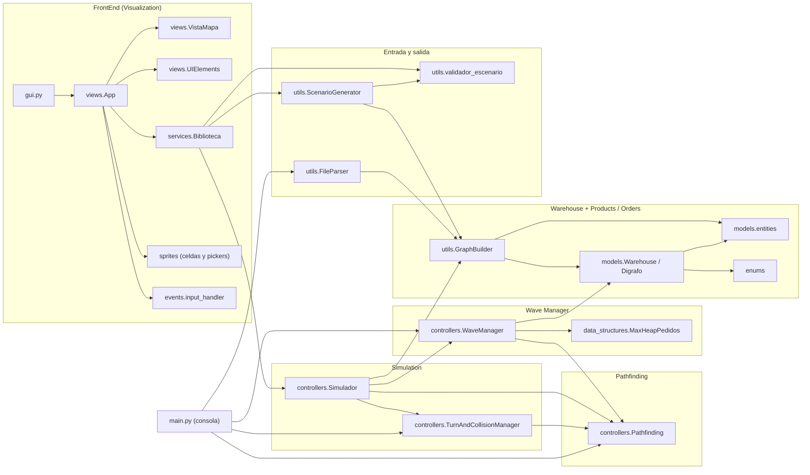
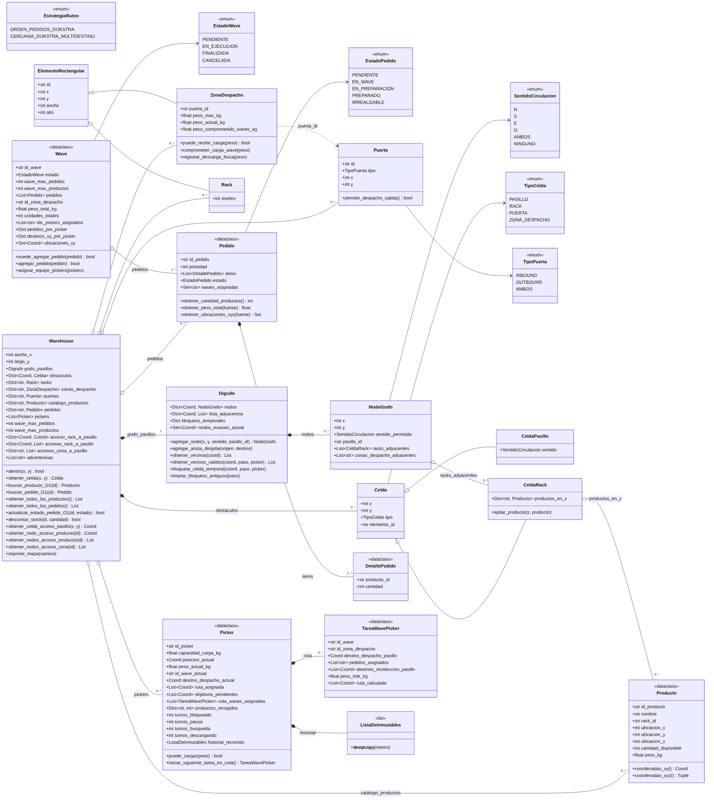
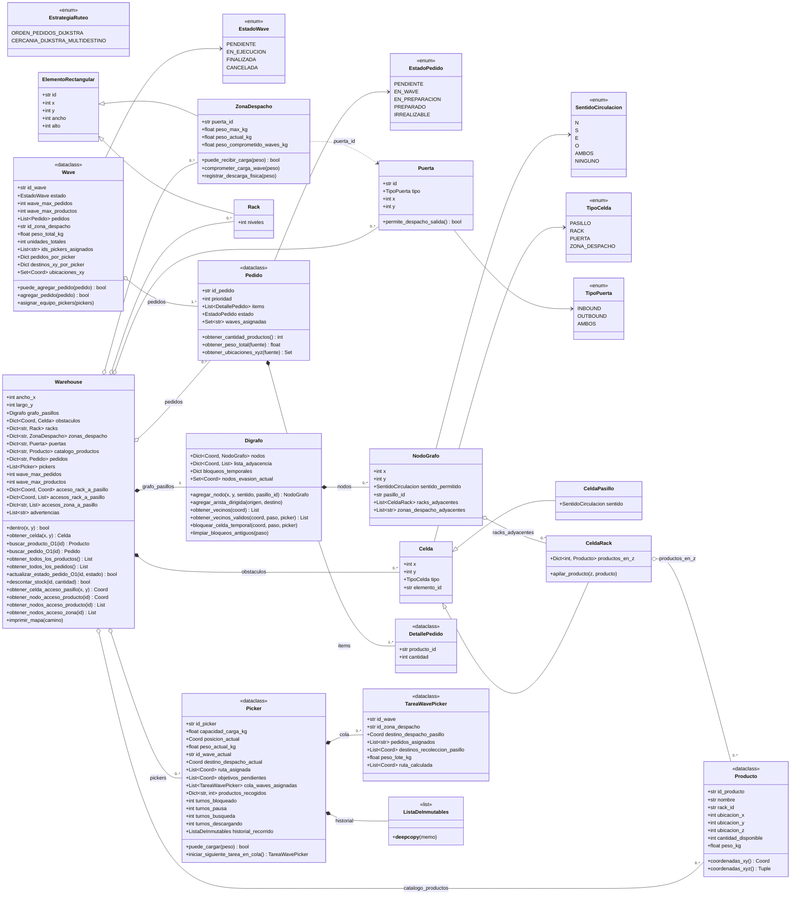
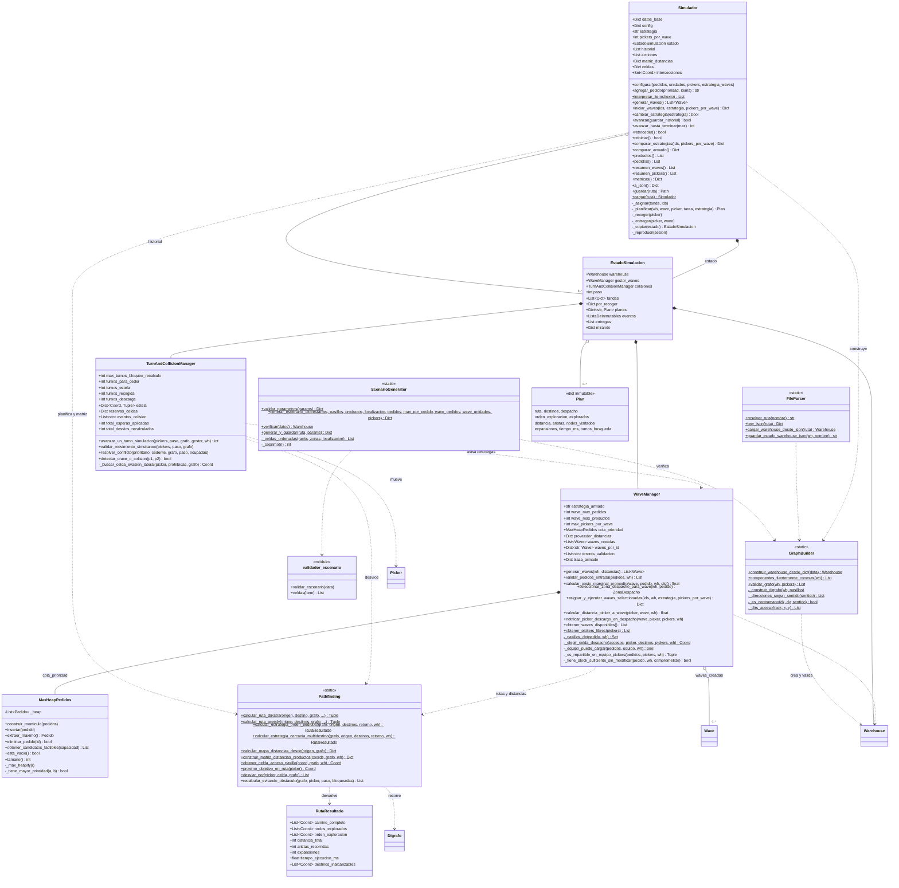
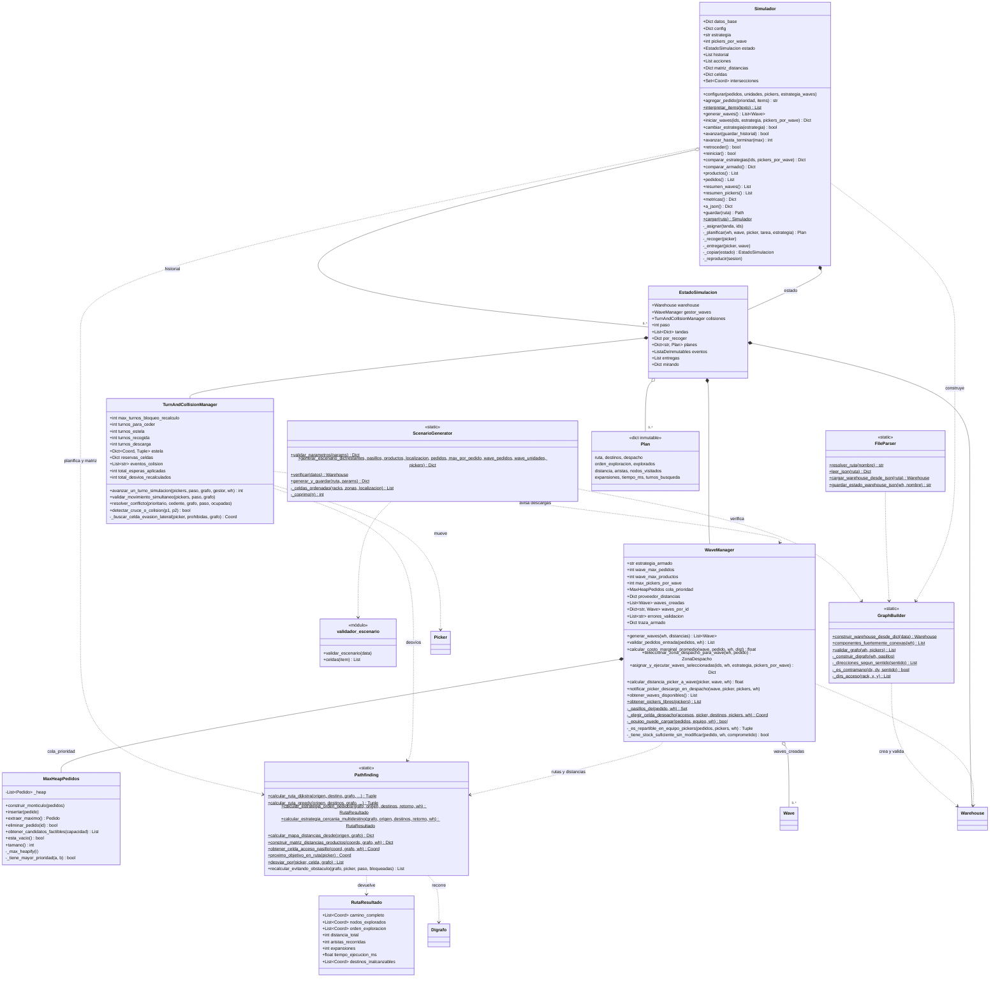
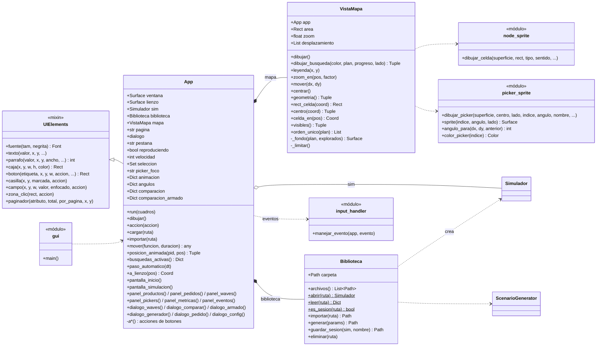

# UML del proyecto

Diagramas de clases armados a partir del código actual de la rama `laure`.
Están divididos en cuatro partes para que se puedan leer:

1. **Vista general**: los paquetes y quién usa a quién.
2. **Modelo**: el almacén, el dígrafo y las entidades (productos, pedidos, waves, pickers).
3. **Lógica**: construcción del grafo, waves, recorridos, colisiones y simulación.
4. **Interfaz**: la aplicación Pygame.

Las imágenes están en `docs/uml/`. Este archivo tiene el código fuente
(Mermaid), que GitHub muestra directamente.

**Convenciones:**

- Visibilidad: `+` público, `-` privado (en Python empieza con `_`).
- `$` marca un método estático.
- `<<dataclass>>` es una clase de datos de Python, `<<enum>>` una enumeración
  y `<<módulo>>` un archivo con funciones sueltas.
- Relaciones:
  - `*--` composición: la parte no existe sin el todo.
  - `o--` agregación: tiene referencias a objetos que existen por su cuenta.
  - `<|--` herencia.
  - `..>` dependencia: usa, crea o recibe.
- `Coord` es `Tuple[int, int]`.

---

## 1. Vista general (paquetes)

---

## 2. Modelo: almacén, dígrafo y entidades

---

## 3. Lógica: grafo, waves, recorridos, colisiones y simulación

---

## 4. Interfaz (Pygame)

---

## Clases que no usa nadie

Siguen en el repositorio, pero ningún módulo las importa:

| Clase | Archivo | Observación |
|---|---|---|
| `CatalogManager`, `HashTableUniversal`, `NodoHash` | `BackEnd/models/catalog_manager.py` | Catálogo con hashing universal de una versión anterior. Hoy el `Warehouse` guarda productos y pedidos en diccionarios. |
| `GrafoWarehouse` | `BackEnd/data_structures/grafo_warehouse.py` | Grafo anterior basado en una grilla. Importa `BackEnd.models.warehouse_models`, que no existe. |
| `EstadoSimulacion` (enum) | `BackEnd/enums/enums.py` | No tiene nada que ver con la clase `EstadoSimulacion` del simulador, que es la que sí se usa. |
