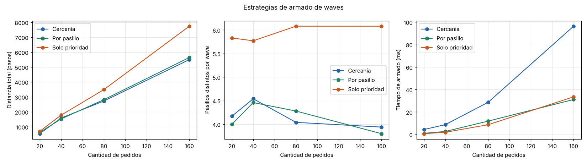

# Resultados experimentales

Generado por `experimentos/ejecutar_experimentos.py`.

Escenario base: {'cantidad_estantes': 24, 'cantidad_pasillos': 7, 'cantidad_productos': 200, 'localizacion': 'DISTRIBUIDA', 'cantidad_pedidos': 40, 'max_productos_por_pedido': 5, 'wave_max_pedidos': 4, 'wave_max_productos': 20, 'cantidad_pickers': 4}

### Tamaño del warehouse (estantes)

| Valor | Celdas | Nodos | Productos | Pedidos | Waves | Estrategia | Distancia | Nodos visitados | Nodos explorados | Nodos expandidos | Rutas (ms) | Turnos | Esperas |
|---|---|---|---|---|---|---|---|---|---|---|---|---|---|
| 6 | 294 | 211 | 200 | 40 | 13 | Orden | 1876 | 1037 | 2704 | 11139 | 13.45 | 654 | 116 |
| 6 | 294 | 211 | 200 | 40 | 13 | Cercanía | 886 | 809 | 2486 | 4790 | 5.96 | 403 | 89 |
| 12 | 522 | 356 | 200 | 40 | 13 | Orden | 3324 | 1821 | 4618 | 27471 | 32.67 | 1064 | 129 |
| 12 | 522 | 356 | 200 | 40 | 13 | Cercanía | 1508 | 1364 | 4454 | 10885 | 11.72 | 602 | 50 |
| 24 | 990 | 680 | 200 | 40 | 13 | Orden | 2395 | 1521 | 7628 | 22357 | 24.90 | 772 | 16 |
| 24 | 990 | 680 | 200 | 40 | 13 | Cercanía | 1547 | 1326 | 7194 | 14500 | 20.42 | 587 | 51 |
| 48 | 1802 | 1204 | 200 | 40 | 13 | Orden | 2993 | 2203 | 12939 | 40981 | 39.62 | 938 | 29 |
| 48 | 1802 | 1204 | 200 | 40 | 13 | Cercanía | 2095 | 1899 | 12311 | 25792 | 24.56 | 688 | 28 |
| 96 | 3542 | 2368 | 200 | 40 | 14 | Orden | 4202 | 3329 | 27882 | 80077 | 158.43 | 1371 | 28 |
| 96 | 3542 | 2368 | 200 | 40 | 14 | Cercanía | 3142 | 2974 | 24967 | 53661 | 80.48 | 1050 | 10 |
| 160 | 5858 | 3916 | 200 | 40 | 13 | Orden | 5251 | 4190 | 40318 | 130945 | 263.71 | 1516 | 18 |
| 160 | 5858 | 3916 | 200 | 40 | 13 | Cercanía | 3755 | 3562 | 38758 | 84146 | 135.17 | 1133 | 7 |

### Cantidad de pedidos

| Valor | Celdas | Nodos | Productos | Pedidos | Waves | Estrategia | Distancia | Nodos visitados | Nodos explorados | Nodos expandidos | Rutas (ms) | Turnos | Esperas |
|---|---|---|---|---|---|---|---|---|---|---|---|---|---|
| 10 | 962 | 652 | 200 | 10 | 3 | Orden | 458 | 261 | 1095 | 3813 | 4.60 | 204 | 30 |
| 10 | 962 | 652 | 200 | 10 | 3 | Cercanía | 280 | 220 | 1050 | 2396 | 3.52 | 164 | 33 |
| 20 | 962 | 652 | 200 | 20 | 6 | Orden | 1026 | 568 | 2710 | 9164 | 10.96 | 453 | 14 |
| 20 | 962 | 652 | 200 | 20 | 6 | Cercanía | 540 | 472 | 2344 | 4592 | 5.56 | 268 | 24 |
| 40 | 962 | 652 | 200 | 40 | 13 | Orden | 2435 | 1627 | 7255 | 24094 | 34.64 | 764 | 61 |
| 40 | 962 | 652 | 200 | 40 | 13 | Cercanía | 1587 | 1431 | 7124 | 15831 | 20.20 | 559 | 46 |
| 80 | 962 | 652 | 200 | 80 | 27 | Orden | 4487 | 3018 | 14630 | 44944 | 57.10 | 1498 | 115 |
| 80 | 962 | 652 | 200 | 80 | 27 | Cercanía | 2728 | 2522 | 13333 | 25913 | 40.81 | 993 | 61 |
| 160 | 962 | 652 | 200 | 160 | 52 | Orden | 7960 | 5664 | 28001 | 77978 | 118.36 | 2612 | 125 |
| 160 | 962 | 652 | 200 | 160 | 52 | Cercanía | 5504 | 5022 | 26546 | 53795 | 89.52 | 1909 | 127 |
| 320 | 962 | 652 | 200 | 320 | 100 | Orden | 13831 | 10617 | 54952 | 139211 | 183.41 | 4318 | 234 |
| 320 | 962 | 652 | 200 | 320 | 100 | Cercanía | 10070 | 9309 | 52271 | 101138 | 164.85 | 3365 | 245 |

### Cantidad de productos

| Valor | Celdas | Nodos | Productos | Pedidos | Waves | Estrategia | Distancia | Nodos visitados | Nodos explorados | Nodos expandidos | Rutas (ms) | Turnos | Esperas |
|---|---|---|---|---|---|---|---|---|---|---|---|---|---|
| 25 | 962 | 652 | 25 | 40 | 13 | Orden | 2394 | 2058 | 8395 | 27926 | 52.96 | 738 | 52 |
| 25 | 962 | 652 | 25 | 40 | 13 | Cercanía | 1804 | 1673 | 8129 | 18744 | 36.00 | 606 | 53 |
| 50 | 962 | 652 | 50 | 40 | 13 | Orden | 2574 | 2067 | 8141 | 27882 | 54.85 | 821 | 34 |
| 50 | 962 | 652 | 50 | 40 | 13 | Cercanía | 2004 | 1786 | 8138 | 19702 | 43.36 | 656 | 24 |
| 100 | 962 | 652 | 100 | 40 | 13 | Orden | 3909 | 2698 | 8362 | 48123 | 50.80 | 1175 | 28 |
| 100 | 962 | 652 | 100 | 40 | 13 | Cercanía | 2281 | 2008 | 8141 | 23018 | 23.83 | 724 | 46 |
| 200 | 962 | 652 | 200 | 40 | 13 | Orden | 2435 | 1627 | 7255 | 24094 | 32.97 | 764 | 61 |
| 200 | 962 | 652 | 200 | 40 | 13 | Cercanía | 1587 | 1431 | 7124 | 15831 | 19.67 | 559 | 46 |
| 400 | 962 | 652 | 400 | 40 | 13 | Orden | 3373 | 2318 | 8417 | 37520 | 56.80 | 1038 | 70 |
| 400 | 962 | 652 | 400 | 40 | 13 | Cercanía | 2221 | 1865 | 8280 | 22710 | 24.86 | 812 | 34 |
| 800 | 962 | 652 | 800 | 40 | 13 | Orden | 3438 | 2445 | 8277 | 38186 | 40.64 | 1049 | 72 |
| 800 | 962 | 652 | 800 | 40 | 13 | Cercanía | 2046 | 1852 | 7937 | 19642 | 24.58 | 736 | 41 |

### Localización de los productos

| Valor | Celdas | Nodos | Productos | Pedidos | Waves | Estrategia | Distancia | Nodos visitados | Nodos explorados | Nodos expandidos | Rutas (ms) | Turnos | Esperas |
|---|---|---|---|---|---|---|---|---|---|---|---|---|---|
| CERCA_DESPACHO | 962 | 652 | 200 | 40 | 13 | Orden | 3569 | 2239 | 8285 | 44578 | 51.33 | 1125 | 87 |
| CERCA_DESPACHO | 962 | 652 | 200 | 40 | 13 | Cercanía | 1879 | 1729 | 7916 | 19161 | 24.39 | 655 | 70 |
| POR_RACK | 962 | 652 | 200 | 40 | 12 | Orden | 3207 | 1507 | 7584 | 39324 | 50.60 | 991 | 34 |
| POR_RACK | 962 | 652 | 200 | 40 | 12 | Cercanía | 1449 | 1225 | 6809 | 15625 | 15.78 | 539 | 39 |
| DISTRIBUIDA | 962 | 652 | 200 | 40 | 13 | Orden | 2435 | 1627 | 7255 | 24094 | 31.79 | 764 | 61 |
| DISTRIBUIDA | 962 | 652 | 200 | 40 | 13 | Cercanía | 1587 | 1431 | 7124 | 15831 | 21.82 | 559 | 46 |

### Cantidad de pasillos

| Valor | Celdas | Nodos | Productos | Pedidos | Waves | Estrategia | Distancia | Nodos visitados | Nodos explorados | Nodos expandidos | Rutas (ms) | Turnos | Esperas |
|---|---|---|---|---|---|---|---|---|---|---|---|---|---|
| 3 | 1010 | 711 | 200 | 40 | 13 | Orden | 3366 | 2328 | 7678 | 19770 | 21.40 | 1038 | 67 |
| 3 | 1010 | 711 | 200 | 40 | 13 | Cercanía | 2686 | 2334 | 7344 | 15749 | 13.95 | 847 | 93 |
| 5 | 954 | 644 | 200 | 40 | 12 | Orden | 2466 | 1587 | 6750 | 20806 | 23.09 | 830 | 58 |
| 5 | 954 | 644 | 200 | 40 | 12 | Cercanía | 1504 | 1372 | 5856 | 12417 | 14.41 | 584 | 76 |
| 7 | 962 | 652 | 200 | 40 | 13 | Orden | 2435 | 1627 | 7255 | 24094 | 25.88 | 764 | 61 |
| 7 | 962 | 652 | 200 | 40 | 13 | Cercanía | 1587 | 1431 | 7124 | 15831 | 19.89 | 559 | 46 |
| 9 | 986 | 676 | 200 | 40 | 13 | Orden | 2258 | 1478 | 7486 | 22953 | 29.78 | 779 | 51 |
| 9 | 986 | 676 | 200 | 40 | 13 | Cercanía | 1398 | 1216 | 6575 | 13111 | 16.53 | 563 | 68 |
| 13 | 1050 | 740 | 200 | 40 | 13 | Orden | 2148 | 1314 | 6999 | 21667 | 29.04 | 774 | 33 |
| 13 | 1050 | 740 | 200 | 40 | 13 | Cercanía | 1270 | 1091 | 6312 | 11824 | 26.64 | 475 | 32 |
| 17 | 1386 | 1076 | 200 | 40 | 13 | Orden | 2425 | 1503 | 9129 | 29931 | 37.81 | 987 | 22 |
| 17 | 1386 | 1076 | 200 | 40 | 13 | Cercanía | 1361 | 1225 | 8982 | 15416 | 20.35 | 564 | 29 |

### Tiempo de cada etapa (estrategia Cercanía)

| Serie | Valor | Celdas | Nodos | Aristas | Dígrafo (ms) | Kosaraju (ms) | Matriz (ms) | Pares matriz | Waves (ms) | Candidatos evaluados |
|---|---|---|---|---|---|---|---|---|---|---|
| tamano | 6 | 294 | 211 | 552 | 1.34 | 0.23 | 22.6 | 5184 | 8.83 | 383 |
| tamano | 12 | 522 | 356 | 900 | 2.21 | 0.38 | 85.0 | 20736 | 13.91 | 402 |
| tamano | 24 | 990 | 680 | 1754 | 3.03 | 0.61 | 128.8 | 40000 | 8.60 | 423 |
| tamano | 48 | 1802 | 1204 | 3090 | 11.35 | 2.22 | 406.7 | 40000 | 10.11 | 381 |
| tamano | 96 | 3542 | 2368 | 6150 | 11.29 | 2.49 | 604.4 | 40000 | 11.59 | 371 |
| tamano | 160 | 5858 | 3916 | 10238 | 35.94 | 7.43 | 1245.6 | 40000 | 17.99 | 350 |
| pedidos | 10 | 962 | 652 | 1678 | 4.15 | 0.80 | 172.1 | 40000 | 2.58 | 30 |
| pedidos | 20 | 962 | 652 | 1678 | 6.24 | 1.22 | 249.3 | 40000 | 4.40 | 115 |
| pedidos | 40 | 962 | 652 | 1678 | 4.66 | 0.84 | 187.1 | 40000 | 10.72 | 404 |
| pedidos | 80 | 962 | 652 | 1678 | 4.35 | 0.84 | 159.8 | 40000 | 39.02 | 1447 |
| pedidos | 160 | 962 | 652 | 1678 | 4.59 | 0.84 | 165.9 | 40000 | 124.95 | 5752 |
| pedidos | 320 | 962 | 652 | 1678 | 4.87 | 0.82 | 163.1 | 40000 | 455.25 | 21592 |
| productos | 25 | 962 | 652 | 1678 | 6.60 | 1.29 | 30.8 | 625 | 9.23 | 405 |
| productos | 50 | 962 | 652 | 1678 | 6.30 | 1.26 | 54.0 | 2500 | 9.77 | 365 |
| productos | 100 | 962 | 652 | 1678 | 6.73 | 1.27 | 120.3 | 10000 | 12.50 | 367 |
| productos | 200 | 962 | 652 | 1678 | 4.46 | 0.81 | 185.4 | 40000 | 13.63 | 404 |
| productos | 400 | 962 | 652 | 1678 | 5.29 | 0.95 | 305.6 | 82944 | 13.80 | 340 |
| productos | 800 | 962 | 652 | 1678 | 5.01 | 0.77 | 314.1 | 82944 | 25.05 | 374 |
| localizacion | CERCA_DESPACHO | 962 | 652 | 1678 | 4.71 | 0.86 | 151.8 | 40000 | 9.34 | 389 |
| localizacion | POR_RACK | 962 | 652 | 1678 | 4.17 | 0.94 | 174.9 | 40000 | 11.13 | 357 |
| localizacion | DISTRIBUIDA | 962 | 652 | 1678 | 4.74 | 0.89 | 186.9 | 40000 | 13.62 | 404 |
| pasillos | 3 | 1010 | 711 | 1720 | 4.52 | 0.84 | 180.6 | 40000 | 12.33 | 392 |
| pasillos | 5 | 954 | 644 | 1602 | 3.04 | 0.56 | 118.7 | 40000 | 8.16 | 381 |
| pasillos | 7 | 962 | 652 | 1678 | 3.78 | 0.73 | 164.1 | 40000 | 12.40 | 404 |
| pasillos | 9 | 986 | 676 | 1788 | 4.95 | 0.88 | 270.7 | 40000 | 15.21 | 400 |
| pasillos | 13 | 1050 | 740 | 2042 | 4.46 | 0.92 | 193.6 | 40000 | 12.08 | 402 |
| pasillos | 17 | 1386 | 1076 | 3242 | 6.46 | 1.47 | 288.9 | 40000 | 10.59 | 411 |

### Estrategias de armado de waves (recorrido con Cercanía)

| Escenario | Armado | Waves | Pedidos/wave | Pasillos/wave | Prioridad 1.ª wave | Distancia | Turnos | Armado (ms) | Candidatos |
|---|---|---|---|---|---|---|---|---|---|
| pedidos=20 | Cercanía | 6 | 3.33 | 4.17 | 2.75 | 540 | 268 | 4.39 | 115 |
| pedidos=20 | Por pasillo | 7 | 2.86 | 4.0 | 3.33 | 631 | 293 | 1.00 | 98 |
| pedidos=20 | Solo prioridad | 6 | 3.33 | 5.83 | 3.67 | 698 | 322 | 0.68 | 100 |
| pedidos=40 | Cercanía | 13 | 3.08 | 4.54 | 2.75 | 1587 | 559 | 8.73 | 404 |
| pedidos=40 | Por pasillo | 13 | 3.08 | 4.46 | 3.33 | 1527 | 570 | 2.67 | 358 |
| pedidos=40 | Solo prioridad | 13 | 3.08 | 5.77 | 3.67 | 1780 | 651 | 1.94 | 376 |
| pedidos=80 | Cercanía | 27 | 2.96 | 4.04 | 2.25 | 2728 | 993 | 28.63 | 1447 |
| pedidos=80 | Por pasillo | 25 | 3.2 | 4.28 | 3.33 | 2819 | 1025 | 11.86 | 1375 |
| pedidos=80 | Solo prioridad | 25 | 3.2 | 6.08 | 3.67 | 3492 | 1244 | 8.65 | 1413 |
| pedidos=160 | Cercanía | 52 | 3.08 | 3.94 | 2.5 | 5504 | 1909 | 96.39 | 5752 |
| pedidos=160 | Por pasillo | 49 | 3.27 | 3.8 | 3.33 | 5645 | 2009 | 31.11 | 5446 |
| pedidos=160 | Solo prioridad | 52 | 3.08 | 6.08 | 3.67 | 7744 | 2534 | 33.49 | 6408 |
| localizacion=CERCA_DESPACHO | Cercanía | 13 | 3.08 | 6.38 | 2.25 | 1879 | 655 | 11.53 | 389 |
| localizacion=CERCA_DESPACHO | Por pasillo | 13 | 3.08 | 6.31 | 2.25 | 2000 | 695 | 3.71 | 382 |
| localizacion=CERCA_DESPACHO | Solo prioridad | 13 | 3.08 | 8.23 | 3.67 | 2257 | 737 | 2.70 | 376 |
| localizacion=POR_RACK | Cercanía | 12 | 3.33 | 4.67 | 3.33 | 1449 | 539 | 8.57 | 357 |
| localizacion=POR_RACK | Por pasillo | 13 | 3.08 | 4.08 | 3.33 | 1341 | 511 | 3.69 | 359 |
| localizacion=POR_RACK | Solo prioridad | 13 | 3.08 | 7.08 | 3.67 | 1897 | 639 | 2.05 | 376 |

