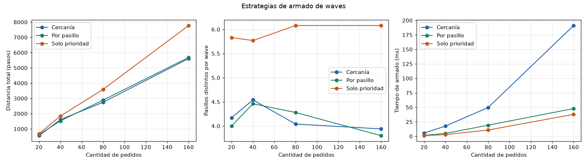

# Resultados experimentales

Generado por `experimentos/ejecutar_experimentos.py`.

Escenario base: {'cantidad_estantes': 24, 'cantidad_pasillos': 7, 'cantidad_productos': 200, 'localizacion': 'DISTRIBUIDA', 'cantidad_pedidos': 40, 'max_productos_por_pedido': 5, 'wave_max_pedidos': 4, 'wave_max_productos': 20, 'cantidad_pickers': 4}

### Tamaño del warehouse (estantes)

| Valor | Celdas | Nodos | Productos | Pedidos | Waves | Estrategia | Distancia | Nodos visitados | Nodos explorados | Nodos expandidos | Rutas (ms) | Turnos | Esperas |
|---|---|---|---|---|---|---|---|---|---|---|---|---|---|
| 6 | 294 | 211 | 200 | 40 | 13 | Orden | 1878 | 1035 | 2704 | 11161 | 12.99 | 724 | 136 |
| 6 | 294 | 211 | 200 | 40 | 13 | Cercanía | 882 | 814 | 2404 | 4734 | 5.99 | 456 | 108 |
| 12 | 522 | 356 | 200 | 40 | 13 | Orden | 3321 | 1820 | 4618 | 27424 | 31.98 | 1140 | 89 |
| 12 | 522 | 356 | 200 | 40 | 13 | Cercanía | 1508 | 1376 | 4436 | 10940 | 20.44 | 705 | 71 |
| 24 | 990 | 680 | 200 | 40 | 13 | Orden | 2395 | 1509 | 7628 | 22374 | 30.17 | 879 | 73 |
| 24 | 990 | 680 | 200 | 40 | 13 | Cercanía | 1545 | 1327 | 7194 | 14473 | 17.93 | 681 | 38 |
| 48 | 1802 | 1204 | 200 | 40 | 13 | Orden | 2993 | 2203 | 12939 | 40981 | 51.41 | 1028 | 66 |
| 48 | 1802 | 1204 | 200 | 40 | 13 | Cercanía | 2095 | 1899 | 12311 | 25792 | 32.30 | 790 | 26 |
| 96 | 3542 | 2368 | 200 | 40 | 14 | Orden | 4202 | 3329 | 27882 | 80077 | 101.55 | 1489 | 56 |
| 96 | 3542 | 2368 | 200 | 40 | 14 | Cercanía | 3142 | 2974 | 24967 | 53661 | 67.68 | 1195 | 38 |
| 160 | 5858 | 3916 | 200 | 40 | 13 | Orden | 5251 | 4190 | 40318 | 130945 | 234.89 | 1660 | 52 |
| 160 | 5858 | 3916 | 200 | 40 | 13 | Cercanía | 3755 | 3562 | 38758 | 84146 | 116.04 | 1226 | 25 |

### Cantidad de pedidos

| Valor | Celdas | Nodos | Productos | Pedidos | Waves | Estrategia | Distancia | Nodos visitados | Nodos explorados | Nodos expandidos | Rutas (ms) | Turnos | Esperas |
|---|---|---|---|---|---|---|---|---|---|---|---|---|---|
| 10 | 962 | 652 | 200 | 10 | 3 | Orden | 458 | 261 | 1095 | 3813 | 4.66 | 236 | 13 |
| 10 | 962 | 652 | 200 | 10 | 3 | Cercanía | 280 | 220 | 1050 | 2396 | 2.96 | 188 | 27 |
| 20 | 962 | 652 | 200 | 20 | 6 | Orden | 1034 | 576 | 2736 | 9262 | 11.25 | 517 | 71 |
| 20 | 962 | 652 | 200 | 20 | 6 | Cercanía | 540 | 472 | 2344 | 4592 | 5.69 | 324 | 22 |
| 40 | 962 | 652 | 200 | 40 | 13 | Orden | 2451 | 1638 | 7255 | 24276 | 28.94 | 854 | 88 |
| 40 | 962 | 652 | 200 | 40 | 13 | Cercanía | 1603 | 1440 | 7128 | 16055 | 17.91 | 668 | 59 |
| 80 | 962 | 652 | 200 | 80 | 27 | Orden | 4493 | 3018 | 14627 | 44977 | 57.15 | 1725 | 91 |
| 80 | 962 | 652 | 200 | 80 | 27 | Cercanía | 2728 | 2522 | 13333 | 25913 | 32.63 | 1198 | 83 |
| 160 | 962 | 652 | 200 | 160 | 52 | Orden | 7948 | 5652 | 27963 | 77783 | 105.13 | 2986 | 198 |
| 160 | 962 | 652 | 200 | 160 | 52 | Cercanía | 5547 | 5073 | 26686 | 54103 | 85.18 | 2317 | 209 |
| 320 | 962 | 652 | 200 | 320 | 100 | Orden | 13786 | 10539 | 54646 | 138591 | 168.42 | 5000 | 311 |
| 320 | 962 | 652 | 200 | 320 | 100 | Cercanía | 10024 | 9255 | 52060 | 100350 | 138.01 | 4140 | 415 |

### Cantidad de productos

| Valor | Celdas | Nodos | Productos | Pedidos | Waves | Estrategia | Distancia | Nodos visitados | Nodos explorados | Nodos expandidos | Rutas (ms) | Turnos | Esperas |
|---|---|---|---|---|---|---|---|---|---|---|---|---|---|
| 25 | 962 | 652 | 25 | 40 | 13 | Orden | 2394 | 2058 | 8395 | 27926 | 35.19 | 858 | 58 |
| 25 | 962 | 652 | 25 | 40 | 13 | Cercanía | 1804 | 1673 | 8129 | 18744 | 22.86 | 719 | 72 |
| 50 | 962 | 652 | 50 | 40 | 13 | Orden | 2574 | 2067 | 8141 | 27882 | 36.89 | 911 | 35 |
| 50 | 962 | 652 | 50 | 40 | 13 | Cercanía | 2004 | 1786 | 8138 | 19702 | 24.91 | 746 | 24 |
| 100 | 962 | 652 | 100 | 40 | 13 | Orden | 3909 | 2698 | 8362 | 48123 | 79.80 | 1268 | 62 |
| 100 | 962 | 652 | 100 | 40 | 13 | Cercanía | 2281 | 2008 | 8141 | 23018 | 32.36 | 831 | 50 |
| 200 | 962 | 652 | 200 | 40 | 13 | Orden | 2451 | 1638 | 7255 | 24276 | 30.94 | 854 | 88 |
| 200 | 962 | 652 | 200 | 40 | 13 | Cercanía | 1603 | 1440 | 7128 | 16055 | 20.53 | 668 | 59 |
| 400 | 962 | 652 | 400 | 40 | 13 | Orden | 3373 | 2318 | 8417 | 37520 | 45.87 | 1158 | 62 |
| 400 | 962 | 652 | 400 | 40 | 13 | Cercanía | 2221 | 1865 | 8280 | 22710 | 42.33 | 937 | 37 |
| 800 | 962 | 652 | 800 | 40 | 13 | Orden | 3438 | 2445 | 8277 | 38186 | 45.47 | 1150 | 72 |
| 800 | 962 | 652 | 800 | 40 | 13 | Cercanía | 2046 | 1852 | 7937 | 19642 | 23.84 | 856 | 44 |

### Localización de los productos

| Valor | Celdas | Nodos | Productos | Pedidos | Waves | Estrategia | Distancia | Nodos visitados | Nodos explorados | Nodos expandidos | Rutas (ms) | Turnos | Esperas |
|---|---|---|---|---|---|---|---|---|---|---|---|---|---|
| CERCA_DESPACHO | 962 | 652 | 200 | 40 | 13 | Orden | 3569 | 2239 | 8285 | 44578 | 53.61 | 1242 | 75 |
| CERCA_DESPACHO | 962 | 652 | 200 | 40 | 13 | Cercanía | 1875 | 1723 | 7895 | 19070 | 21.69 | 775 | 45 |
| POR_RACK | 962 | 652 | 200 | 40 | 12 | Orden | 3214 | 1505 | 7584 | 39376 | 37.44 | 1046 | 38 |
| POR_RACK | 962 | 652 | 200 | 40 | 12 | Cercanía | 1449 | 1225 | 6809 | 15625 | 30.34 | 626 | 40 |
| DISTRIBUIDA | 962 | 652 | 200 | 40 | 13 | Orden | 2451 | 1638 | 7255 | 24276 | 45.86 | 854 | 88 |
| DISTRIBUIDA | 962 | 652 | 200 | 40 | 13 | Cercanía | 1603 | 1440 | 7128 | 16055 | 19.78 | 668 | 59 |

### Cantidad de pasillos

| Valor | Celdas | Nodos | Productos | Pedidos | Waves | Estrategia | Distancia | Nodos visitados | Nodos explorados | Nodos expandidos | Rutas (ms) | Turnos | Esperas |
|---|---|---|---|---|---|---|---|---|---|---|---|---|---|
| 3 | 1010 | 711 | 200 | 40 | 13 | Orden | 3366 | 2328 | 7678 | 19770 | 25.27 | 1129 | 67 |
| 3 | 1010 | 711 | 200 | 40 | 13 | Cercanía | 2686 | 2334 | 7344 | 15749 | 18.36 | 939 | 105 |
| 5 | 954 | 644 | 200 | 40 | 12 | Orden | 2468 | 1596 | 6719 | 20788 | 33.34 | 908 | 72 |
| 5 | 954 | 644 | 200 | 40 | 12 | Cercanía | 1504 | 1372 | 5856 | 12417 | 23.42 | 672 | 73 |
| 7 | 962 | 652 | 200 | 40 | 13 | Orden | 2451 | 1638 | 7255 | 24276 | 34.66 | 854 | 88 |
| 7 | 962 | 652 | 200 | 40 | 13 | Cercanía | 1603 | 1440 | 7128 | 16055 | 20.29 | 668 | 59 |
| 9 | 986 | 676 | 200 | 40 | 13 | Orden | 2258 | 1478 | 7486 | 22953 | 29.20 | 895 | 69 |
| 9 | 986 | 676 | 200 | 40 | 13 | Cercanía | 1398 | 1216 | 6575 | 13111 | 17.26 | 690 | 83 |
| 13 | 1050 | 740 | 200 | 40 | 13 | Orden | 2126 | 1298 | 6793 | 21447 | 29.49 | 858 | 37 |
| 13 | 1050 | 740 | 200 | 40 | 13 | Cercanía | 1240 | 1065 | 6043 | 11856 | 12.69 | 564 | 47 |
| 17 | 1386 | 1076 | 200 | 40 | 13 | Orden | 2449 | 1524 | 9938 | 30258 | 30.85 | 1080 | 52 |
| 17 | 1386 | 1076 | 200 | 40 | 13 | Cercanía | 1373 | 1235 | 8997 | 15625 | 21.06 | 657 | 28 |

### Tiempo de cada etapa (estrategia Cercanía)

| Serie | Valor | Celdas | Nodos | Aristas | Dígrafo (ms) | Kosaraju (ms) | Matriz (ms) | Pares matriz | Waves (ms) | Candidatos evaluados |
|---|---|---|---|---|---|---|---|---|---|---|
| tamano | 6 | 294 | 211 | 552 | 1.28 | 0.22 | 17.2 | 5184 | 8.40 | 383 |
| tamano | 12 | 522 | 356 | 900 | 2.43 | 0.41 | 70.6 | 20736 | 9.63 | 402 |
| tamano | 24 | 990 | 680 | 1754 | 6.25 | 1.23 | 260.0 | 40000 | 11.86 | 423 |
| tamano | 48 | 1802 | 1204 | 3090 | 8.14 | 1.53 | 276.6 | 40000 | 8.39 | 381 |
| tamano | 96 | 3542 | 2368 | 6150 | 14.62 | 3.35 | 575.1 | 40000 | 10.47 | 371 |
| tamano | 160 | 5858 | 3916 | 10238 | 38.26 | 8.68 | 1115.2 | 40000 | 10.02 | 350 |
| pedidos | 10 | 962 | 652 | 1678 | 3.91 | 0.77 | 154.4 | 40000 | 2.41 | 30 |
| pedidos | 20 | 962 | 652 | 1678 | 3.90 | 0.77 | 152.7 | 40000 | 4.30 | 115 |
| pedidos | 40 | 962 | 652 | 1678 | 3.86 | 0.77 | 152.7 | 40000 | 10.05 | 404 |
| pedidos | 80 | 962 | 652 | 1678 | 3.12 | 0.60 | 147.2 | 40000 | 50.38 | 1447 |
| pedidos | 160 | 962 | 652 | 1678 | 3.99 | 0.75 | 155.9 | 40000 | 105.04 | 5752 |
| pedidos | 320 | 962 | 652 | 1678 | 6.59 | 1.12 | 199.9 | 40000 | 487.29 | 21592 |
| productos | 25 | 962 | 652 | 1678 | 5.77 | 1.22 | 19.2 | 625 | 6.90 | 405 |
| productos | 50 | 962 | 652 | 1678 | 3.95 | 0.75 | 35.8 | 2500 | 6.85 | 365 |
| productos | 100 | 962 | 652 | 1678 | 3.72 | 0.75 | 74.5 | 10000 | 8.18 | 367 |
| productos | 200 | 962 | 652 | 1678 | 4.09 | 0.79 | 183.5 | 40000 | 14.61 | 404 |
| productos | 400 | 962 | 652 | 1678 | 4.71 | 0.83 | 324.8 | 82944 | 11.40 | 340 |
| productos | 800 | 962 | 652 | 1678 | 4.96 | 0.78 | 235.5 | 82944 | 14.24 | 374 |
| localizacion | CERCA_DESPACHO | 962 | 652 | 1678 | 3.84 | 0.75 | 154.2 | 40000 | 9.74 | 389 |
| localizacion | POR_RACK | 962 | 652 | 1678 | 3.16 | 0.61 | 120.7 | 40000 | 7.62 | 357 |
| localizacion | DISTRIBUIDA | 962 | 652 | 1678 | 6.03 | 1.21 | 165.9 | 40000 | 16.25 | 404 |
| pasillos | 3 | 1010 | 711 | 1720 | 4.04 | 0.74 | 181.9 | 40000 | 10.62 | 392 |
| pasillos | 5 | 954 | 644 | 1602 | 3.89 | 0.74 | 150.3 | 40000 | 10.04 | 381 |
| pasillos | 7 | 962 | 652 | 1678 | 6.08 | 1.22 | 177.1 | 40000 | 12.91 | 404 |
| pasillos | 9 | 986 | 676 | 1788 | 4.36 | 0.85 | 166.3 | 40000 | 11.43 | 400 |
| pasillos | 13 | 1050 | 740 | 2042 | 4.68 | 1.01 | 180.5 | 40000 | 10.80 | 402 |
| pasillos | 17 | 1386 | 1076 | 3242 | 5.47 | 1.12 | 248.3 | 40000 | 9.00 | 411 |

### Estrategias de armado de waves (recorrido con Cercanía)

| Escenario | Armado | Waves | Pedidos/wave | Pasillos/wave | Prioridad 1.ª wave | Distancia | Turnos | Armado (ms) | Candidatos |
|---|---|---|---|---|---|---|---|---|---|
| pedidos=20 | Cercanía | 6 | 3.33 | 4.17 | 2.75 | 540 | 324 | 2.62 | 115 |
| pedidos=20 | Por pasillo | 7 | 2.86 | 4.0 | 3.33 | 631 | 348 | 0.97 | 98 |
| pedidos=20 | Solo prioridad | 6 | 3.33 | 5.83 | 3.67 | 698 | 382 | 0.70 | 100 |
| pedidos=40 | Cercanía | 13 | 3.08 | 4.54 | 2.75 | 1603 | 668 | 8.39 | 404 |
| pedidos=40 | Por pasillo | 13 | 3.08 | 4.46 | 3.33 | 1527 | 690 | 4.63 | 358 |
| pedidos=40 | Solo prioridad | 13 | 3.08 | 5.77 | 3.67 | 1780 | 756 | 2.69 | 376 |
| pedidos=80 | Cercanía | 27 | 2.96 | 4.04 | 2.25 | 2728 | 1198 | 27.63 | 1447 |
| pedidos=80 | Por pasillo | 25 | 3.2 | 4.28 | 3.33 | 2831 | 1233 | 8.52 | 1375 |
| pedidos=80 | Solo prioridad | 25 | 3.2 | 6.08 | 3.67 | 3508 | 1434 | 5.80 | 1413 |
| pedidos=160 | Cercanía | 52 | 3.08 | 3.94 | 2.5 | 5547 | 2317 | 83.16 | 5752 |
| pedidos=160 | Por pasillo | 49 | 3.27 | 3.8 | 3.33 | 5584 | 2364 | 29.19 | 5446 |
| pedidos=160 | Solo prioridad | 52 | 3.08 | 6.08 | 3.67 | 7734 | 2938 | 22.01 | 6408 |
| localizacion=CERCA_DESPACHO | Cercanía | 13 | 3.08 | 6.38 | 2.25 | 1875 | 775 | 6.63 | 389 |
| localizacion=CERCA_DESPACHO | Por pasillo | 13 | 3.08 | 6.31 | 2.25 | 2000 | 815 | 2.29 | 382 |
| localizacion=CERCA_DESPACHO | Solo prioridad | 13 | 3.08 | 8.23 | 3.67 | 2258 | 863 | 1.50 | 376 |
| localizacion=POR_RACK | Cercanía | 12 | 3.33 | 4.67 | 3.33 | 1449 | 626 | 5.79 | 357 |
| localizacion=POR_RACK | Por pasillo | 13 | 3.08 | 4.08 | 3.33 | 1356 | 663 | 3.54 | 359 |
| localizacion=POR_RACK | Solo prioridad | 13 | 3.08 | 7.08 | 3.67 | 1897 | 760 | 2.98 | 376 |

