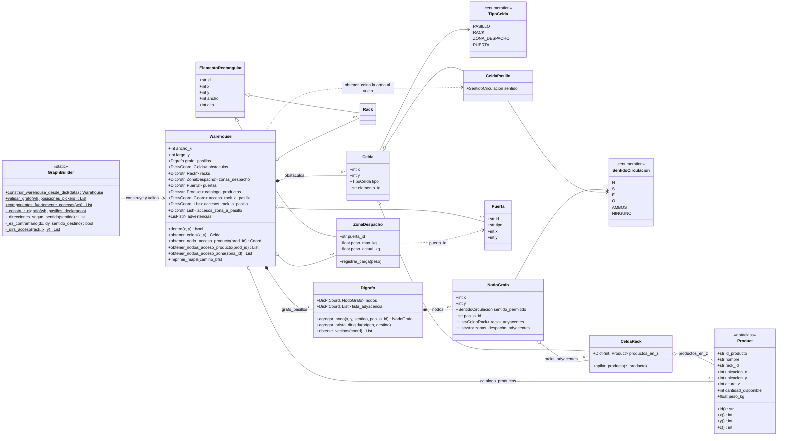

# Diagrama de clases del grafo del almacén

Generado a partir de `BackEnd/enums/enums.py`, `BackEnd/models/entity.py`, `BackEnd/models/warehouse.py` y `BackEnd/utils/graph_builder.py`. De `entity.py` se muestran solo las clases que usa el grafo (también tiene `Order`, `Picker`, `Wave` y `DetallePedido`, que son del equipo). `Sentido` es un alias de `SentidoCirculacion`.
`Coord` es un alias de tipo para `Tuple[int, int]`.

## ¿Qué es nodo y qué no?

No hay una matriz con todas las celdas. Cada coordenada `(x, y)` del almacén está en **uno solo** de estos dos diccionarios: `grafo_pasillos.nodos` (pasillos) o `obstaculos` (lo demás).

| Celda / elemento | ¿Es nodo del grafo? | Dónde se guarda y cómo se relaciona con el grafo |
|---|---|---|
| Pasillo declarado (N, S, E, O, AMBOS) | **Sí** | `grafo_pasillos.nodos`, con `pasillo_id` y su sentido. Sus aristas salientes dependen de su sentido y del sentido del destino (sin contramano). |
| Celda no declarada | **Sí** | `grafo_pasillos.nodos`, con sentido AMBOS y `pasillo_id = None` (enunciado 3.5). |
| Pasillo con sentido NINGUNO | Sí, pero aislado | No tiene aristas de salida y nadie puede entrar (siempre es contramano). |
| Rack (`CeldaRack`) | **No** | `obstaculos`, con su pila `productos_en_z`. Cada celda se recoge desde el pasillo de su costado largo: `accesos_rack_a_pasillo`, `NodoGrafo.racks_adyacentes`. |
| Zona de despacho | **No** | `obstaculos` (tipo `ZONA_DESPACHO`). Sus pasillos pegados están en `accesos_zona_a_pasillo` y en `NodoGrafo.zonas_despacho_adyacentes`. |
| Puerta | **No** | `obstaculos` (tipo `PUERTA`) y `wh.puertas`. No interviene en el grafo. |
